# AVAOrion

[](https://github.com/Harlock123/AVAOrion/actions/workflows/build.yml)

A game of the stars in the spirit of the 1993 classic **Master of Orion**, built with .NET 10 and
Avalonia UI. From the year 2300, lead a star-faring people out into a new galaxy every game:
- **Expansion:** explore the stars and settle new worlds.
- **Economy:** share each colony's output between ships, defence, industry, ecology and research.
- **Fleets:** design your own warships and send them out.
- **Diplomacy:** deal with the peoples you meet in treaties, trade and war.

Win when the Galactic Council elects you High Sovereign of the stars, or by conquering every
rival.

The eight peoples, their worlds, their ships, the Vault of Aeon and its Warden, and all the words
and pictures are original. This is the *style* of the classic, not its contents.

## A galaxy waiting to be won

1. **Choose a people**, a ruler's name, and the galaxy:
   - **Size:** small, medium or large.
   - **Rivals:** one to seven of them.
   - **Difficulty:** Cadet to Admiral.
2. **Explore**: your scouts carry extra fuel; your colony ship waits for a good world.
   - **Fuel range:** ships can only fly within range of your colonies. Better fuel cells reach further.
   - **Stars and planets:** a star's colour tells you what its planet is likely to be. Yellow stars favour green worlds; red, white and blue the hard ones.
3. **Settle**:
   - **Kind worlds** (terran, ocean, jungle, arid, steppe, desert, tundra) can be settled from the start.
   - **Hostile worlds** (barren, dead, toxic, inferno, radiated) each need a discovery first.
   - **Size, minerals, fertility and ancient ruins** decide how much a world is worth.
4. **Run your colonies** with five sliders:
   - **Ships:** whatever the shipyard is building.
   - **Defence:** missile bases.
   - **Industry:** factories, as many as the people can run.
   - **Ecology:** cleaning up the waste, then growing the colony and terraforming it.
   - **Research:** discoveries.
5. **Research** six fields side by side: Computers, Construction, Force Fields, Planetology,
   Propulsion and Weapons. There are ninety discoveries, from the battle computer to the
   Annihilator. Set each field's share, and choose what each studies next.
6. **Design ships** in the design room:
   - **Hulls:** four sizes.
   - **Fittings:** armour, shields, battle computers, ECM jammers, three weapon mounts, colony pods and reserve tanks.
   - **The shipyards:** up to six designs on offer at once.
7. **Fight**:
   - **Battles:** when fleets of peoples at war meet, they fight it out round by round, and you watch the beams and missiles fly.
   - **Retreat:** a side hopelessly outgunned withdraws.
   - **Bombardment:** a colony left without bases is bombed.
   - **Invasion:** once its orbit is clear, send transports of colonists down to take it, and with it some of its people's learning.
8. **Win**:
   - **The Galactic Council:** it sits every 25 years from 2450, and each people has votes by its population. Two thirds of all the votes elects a High Sovereign.
   - **Defying the Council:** if a rival is elected, you may defy the Council, but then every other people goes to war with you.
   - **Conquest:** take every rival's worlds.
   - **The year 2700:** if no one has won by then, the greatest people stands highest.

## Features

- **Eight peoples, each with a gift and a temper**:

  | People | Ruler | Gift |
  |---|---|---|
  | Halcyons | First Speaker Seren Vale | born diplomats: better liked, better trade |
  | Vorrak | Warmaster Gharesh | natural gunners: their ships aim truer |
  | Siltari | Hive-Mother Oss | tireless workers: half again the industry |
  | Ylem | Choir of Aurum | crystal minds: half again the research |
  | Marrow | Brood-Queen Ix | prolific breeders: colonies grow twice as fast |
  | Quorn | Grand Lith Basaltan | stone beings: settle barren worlds from the start, fearsome on the ground |
  | Aethon | Skylord Peregrin | sky-born pilots: their ships are harder to hit |
  | Nereid | Tidecaller Shoa | children of the deep: their seas hold more people |

- **Computer rulers who play by the same rules**, apart from the research bonus that harder levels give them. They:
  - explore and settle the best worlds in reach
  - balance every colony's sliders
  - redesign their warships as they learn
  - spend their reserve hurrying their shipyards
  - guard threatened colonies
  - gather their fleets and strike the weakest enemy colony in reach, then send transports to take it
  - sign pacts and trade agreements with those they like, make war by their nature and their strength, demand tribute from the weak, and vote in the Council by who they like
- **The Vault of Aeon** at the galaxy's heart: the richest world of all, guarded by the Warden. Beat it and settle Aeon, and three advanced discoveries are yours.
- **The galaxy's surprises**:
  - plagues
  - derelict ships full of secrets
  - new mineral seams
  - the Void Leviathan, a living ship that hunts colonies
- **Diplomacy**:
  - non-aggression pacts and alliances
  - trade agreements that pay every year
  - exchanges of discoveries, gifts, and declarations of war
  - **Memory:** they remember who broke a treaty.
- **The screens**:
  - **The galaxy:** nebulae, twinkling stars, your fuel range and fleets in flight.
  - **Colonies:** each planet painted pixel by pixel.
  - **The design room**, battle replays, research, other peoples, and the state of the galaxy with every people's votes.
- **Sound**:
  - **Music:** a rising theme for the title, a quiet one for peace, a driving one for war, and battle music.
  - **Fanfares** for the Council and for discoveries.
  - **Effects:** beams, missiles, explosions, shields, launches and landings. All mixed by OpenAL.
- **Attract mode**: leave the title alone for 30 seconds and a galaxy plays itself.
- **Saved games** in five slots, and a chronicle of everything that happened.
- **Any window size**: the screen scales to fit, letterboxed. **Ctrl+S** saves a screenshot.
- **One self-contained executable** per platform: Windows, macOS and Linux on Intel/AMD and ARM.

## Screenshots

| The title | Which people? | A new reign |
|:---------:|:-------------:|:-----------:|
| 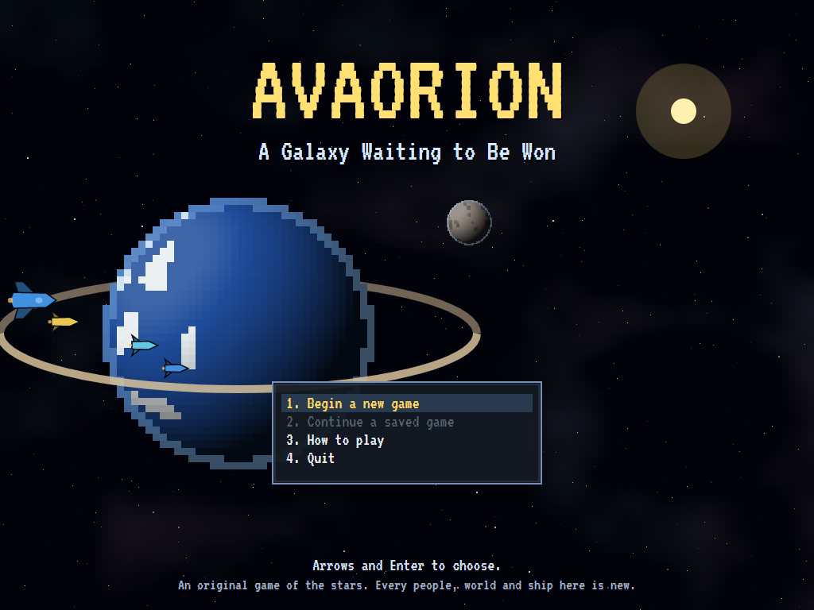 | 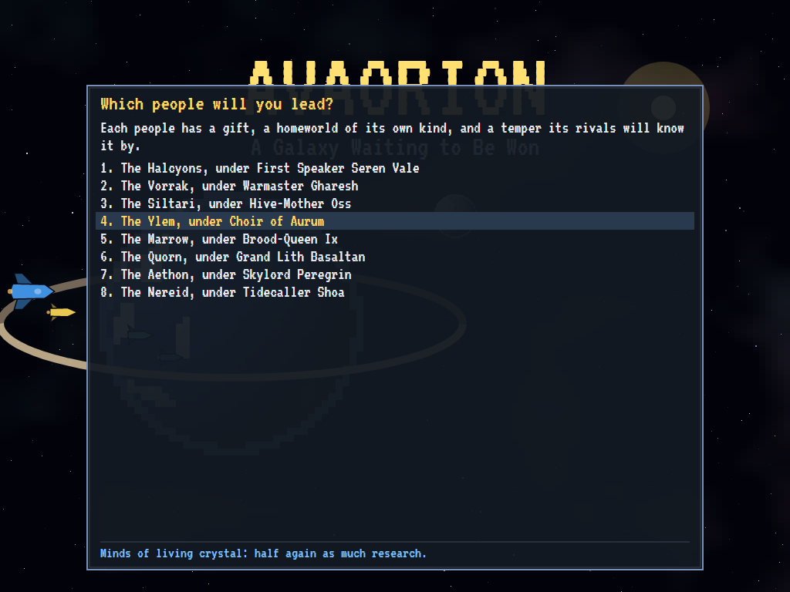 | 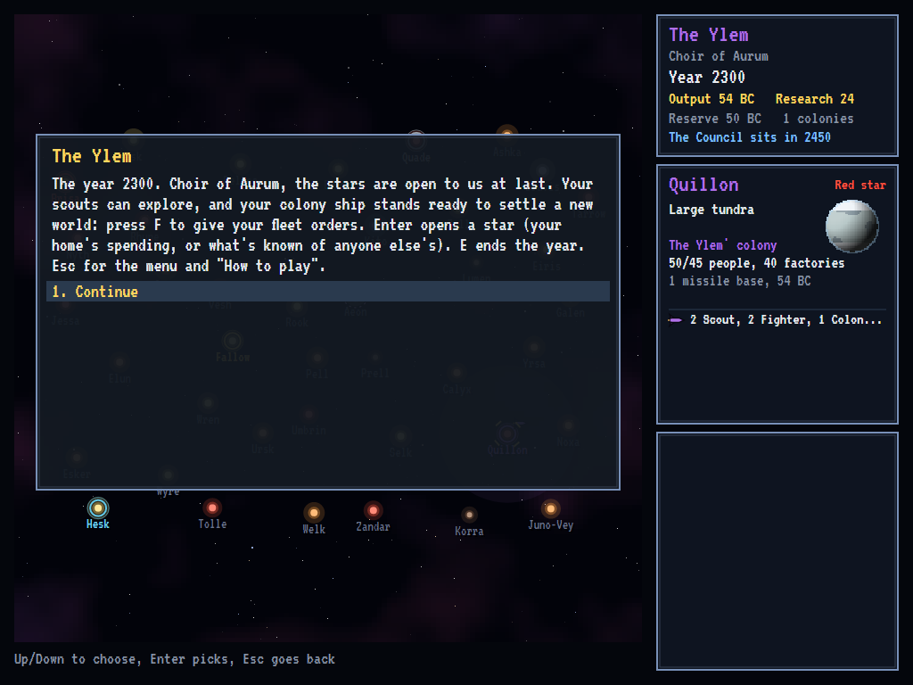 |
| A ringed world, and a fleet passing. | Eight peoples, eight gifts. | The year 2300, and one world to start from. |

| The galaxy | A colony | Research |
|:----------:|:--------:|:--------:|
| 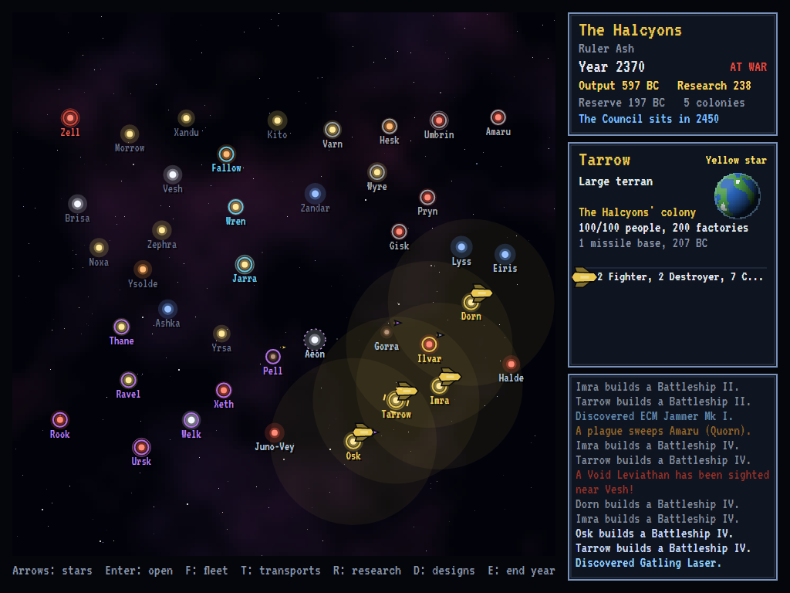 | 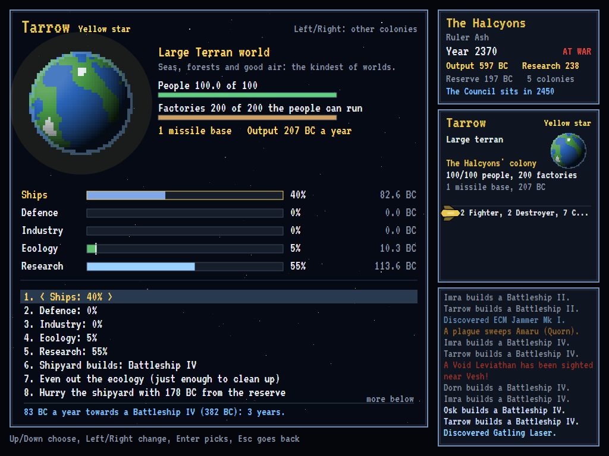 | 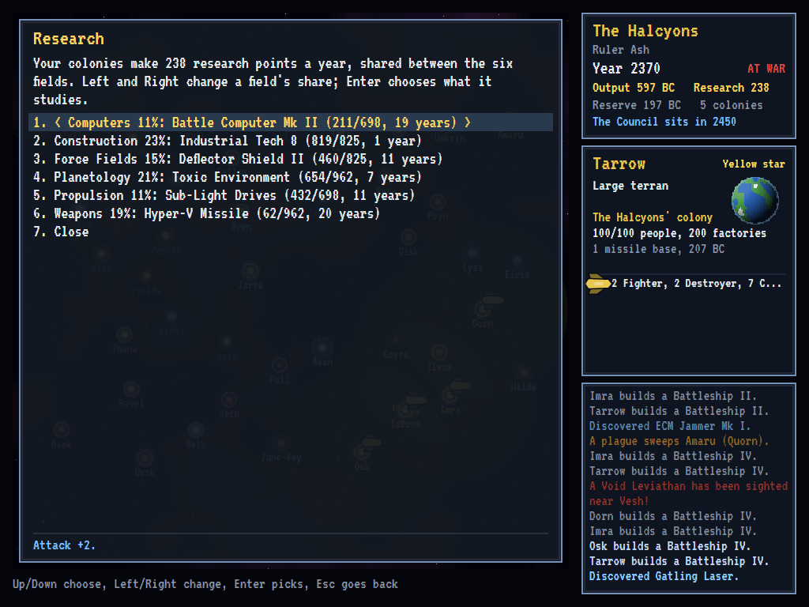 |
| The Halcyons in 2370, their range glowing gold. | Pell, a large terran world, and its five sliders. | Six fields, studied side by side. |

| The design room | A battle | Its end |
|:---------------:|:--------:|:-------:|
| 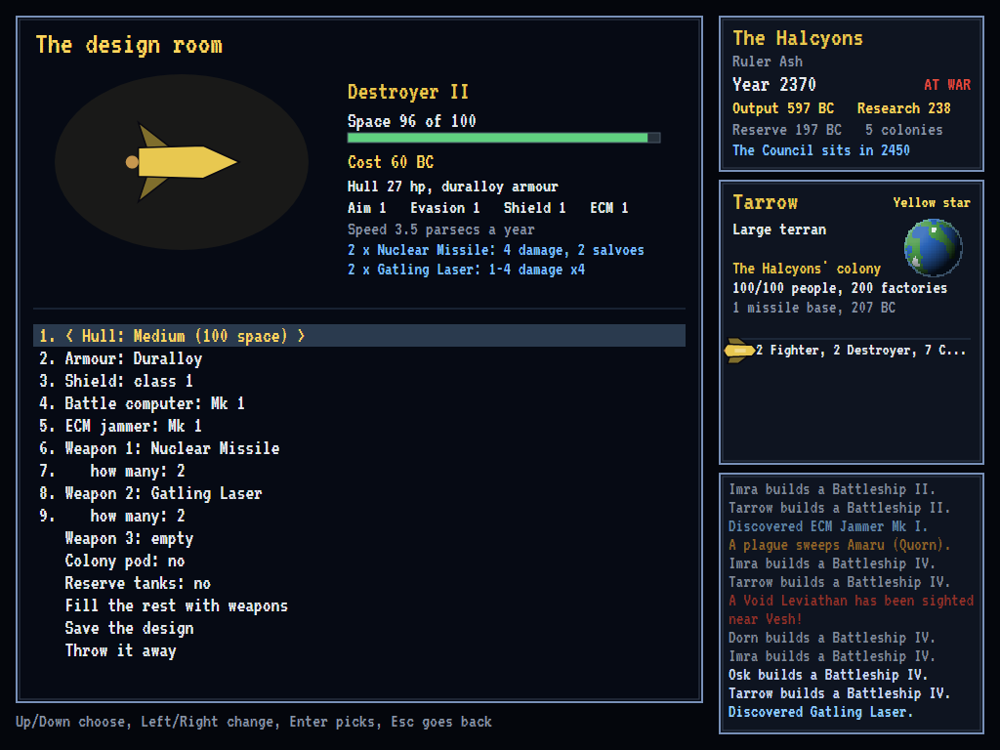 | 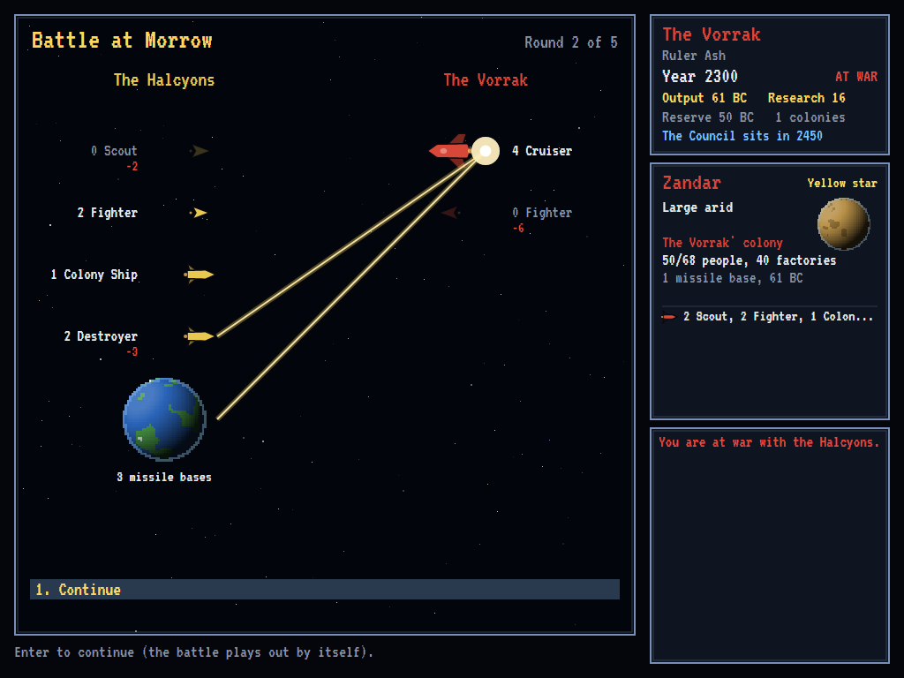 | 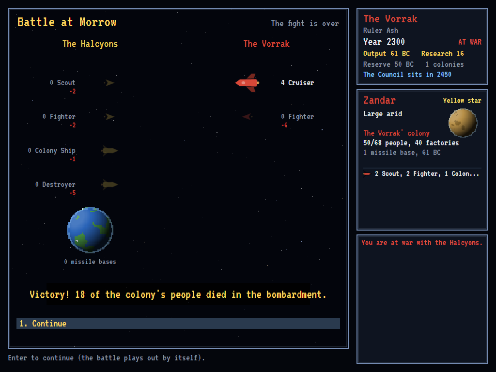 |
| Shields, computers, jammers and guns. | Beams and missiles, round by round. | A colony left without defenders is bombed. |

| Orders for a fleet | Choosing where | Other peoples |
|:------------------:|:--------------:|:-------------:|
| 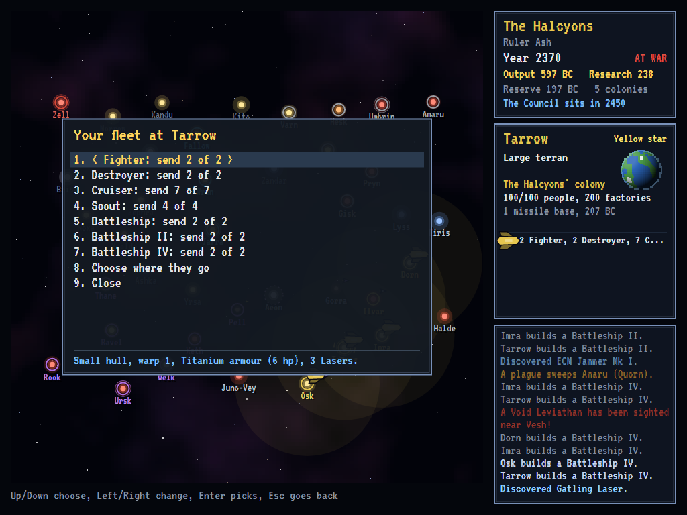 | 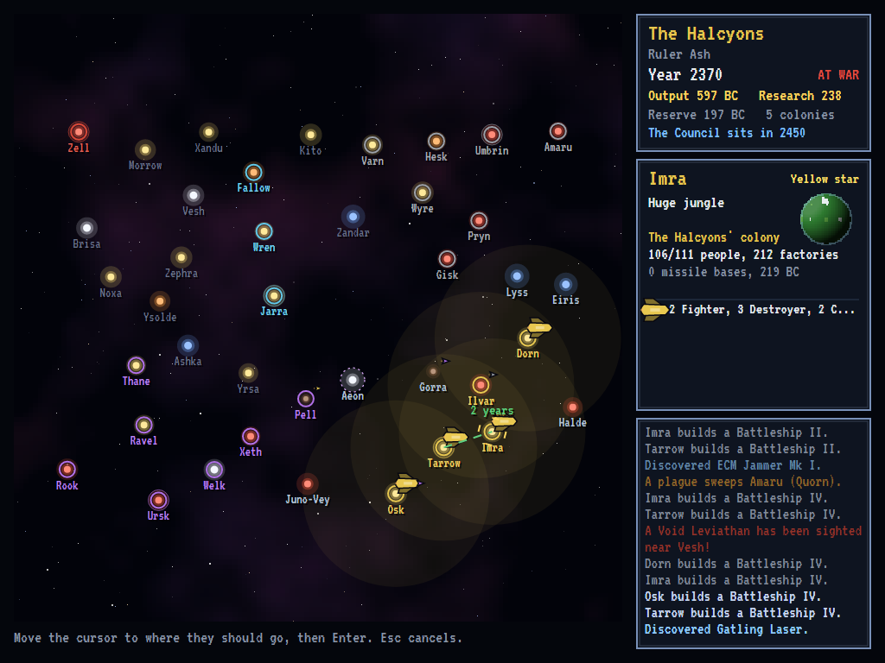 | 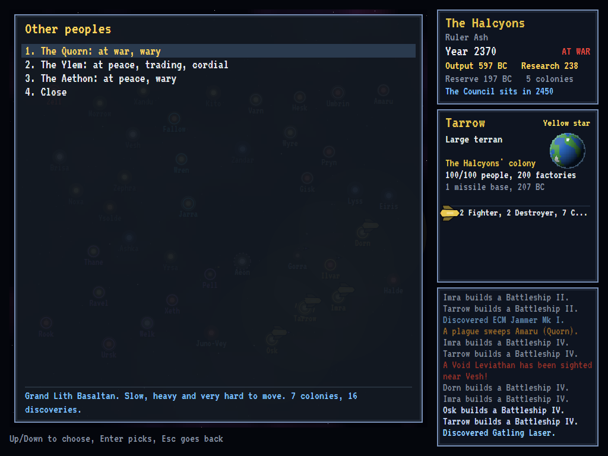 |
| How many of each to send. | Two years to Dravis, in range. | At war, at peace, and trading. |

The tests make these screenshots by playing the game in a real (headless) window; see
[Tests](#tests).

## Download and run

The [Releases page](https://github.com/Harlock123/AVAOrion/releases/tag/latest) has ready-to-run builds
for Windows, macOS and Linux, on both Intel/AMD and ARM. **Latest build** is rebuilt on every push to
`main`. Each download is one self-contained executable, so there's no .NET to install.

| Platform | Archive |
|---|---|
| Windows | `AVAOrion-win-x64.zip`, `AVAOrion-win-x86.zip`, `AVAOrion-win-arm64.zip` |
| macOS | `AVAOrion-osx-arm64.tar.gz` (Apple silicon), `AVAOrion-osx-x64.tar.gz` (Intel) |
| Linux | `AVAOrion-linux-x64.tar.gz`, `AVAOrion-linux-arm64.tar.gz`, `AVAOrion-linux-arm.tar.gz` |

```bash
tar -xzf AVAOrion-linux-x64.tar.gz     # or linux-arm64, linux-arm, osx-arm64, osx-x64
./AVAOrion
```

On Windows, unzip the archive and run `AVAOrion.exe`. On macOS, if Gatekeeper refuses to open it, run
`xattr -d com.apple.quarantine AVAOrion` once. To play without sound, run it with `--no-audio`.

**Sound** comes through OpenAL Soft, which is built in for every platform. In a virtual machine the
game detects the VM and uses a larger audio buffer, so the sound doesn't break up.

## Controls

| The galaxy | |
|---|---|
| **Arrows**, **Home**/**End**/**Page Up**/**Page Down**, or the number pad | Move the cursor from star to star |
| **Enter** | Open the star: your colony's screen, or what's known of anyone else's |
| **F** | Your fleet at this star: choose ships, then where they go (or found a colony) |
| **T** | Send transports of colonists from this colony |
| **Tab** / **C** | Your next fleet / your next colony |
| **R** / **D** | Research / ship designs |
| **P** / **L** / **G** | Other peoples / your colonies / the state of the galaxy |
| **B** | Watch the last battle again |
| **E** | End the year |
| **Esc** | The menu: the chronicle, save, load, help, retire, quit |

When choosing where something goes, move the cursor to a star and press **Enter** (**Esc**
cancels): the line turns green when the star is in range, red when it's not. In menus, the arrows and
**Enter** choose (or press a number), and **Left** and **Right** change a setting. On a colony's
screen, **Left** and **Right** on its other lines step through your colonies. **F2** or **Ctrl+M**
mutes the sound; **Ctrl+S** saves a screenshot in a `Screenshots` folder beside the program.

## Tests

```bash
dotnet test AVAOrion.slnx
```

The rules have no UI: a galaxy state, the rules that act on it, and the computer rulers. The game
engine takes its keys by name, so the tests play exactly as a person does. They check:

- **The galaxy**:
  - **The same every time:** a seed always makes the same galaxy, with stars spaced apart and named once each.
  - **Homes:** every people starts with a home colony, a fleet and good worlds nearby, well away from the others.
  - **The Vault of Aeon** and its guardian.
  - **Discoveries:** every one can be reached, and every weapon is one.
- **Colonies**:
  - **Output:** factories, minerals, and how many factories people can run.
  - **Sliders:** always adding up to a hundred.
  - **Spending:** factories and ships built, missile bases from defence spending.
  - **Ecology:** waste poisoning a world, and ecology growing a young colony.
  - **Hostile worlds:** needing a discovery to settle (except for the hardy).
- **Fleets**:
  - **Flight:** speed and fuel range, and reserve tanks.
  - **Splitting** a fleet.
  - **Colonies and transports:** founding a colony, and transports swelling one.
- **War**:
  - **Fleet battles:** the stronger fleet winning (the weaker withdrawing or dying), and shields turning aside weak weapons.
  - **Colonies:** bases defending them, bombing an undefended one, and soldiers taking one (with its secrets, and the last enemy's fall ending the game).
- **Peoples**:
  - **Treaties:** meeting, pacts, war, betrayal and peace.
  - **Research** discovering and moving on, and better designs from better technology.
  - **The Council:** electing with two thirds of the votes, and defying it.
- **The game itself**:
  - **Playing by keys:** a new game, stepping between stars, sending a scout and ending the year, a colony's sliders, research, designing a ship, and every other screen.
  - **Saving and loading**, and the attract demo.
  - **A whole game:** played by the computer through the engine, to its end.

The screenshot tests draw the real screen in a headless window. To refresh the README's pictures:

```bash
ORION_SHOTS=$PWD/Images dotnet test tests/AVAOrion.Tests --filter ScreenshotTests
```

To watch whole games between computer rulers (for tuning):

```bash
ORION_BALANCE=1 ORION_GAMES=3 dotnet test tests/AVAOrion.Tests --filter BalanceProbe --logger "console;verbosity=detailed"
```

## Building

```bash
dotnet build AVAOrion.slnx
dotnet run --project src/AVAOrion
```

You'll need the .NET 10 SDK. `tools/make_sounds.py` makes the sounds and needs only standard-library
Python: `python3 tools/make_sounds.py` rewrites `src/AVAOrion/Sounds`.

## Project structure

```
AVAOrion/
├── AVAOrion.slnx
├── src/AVAOrion/
│   ├── Rules/                     # Planets and stars, the peoples, discoveries, hulls and weapons, the RNG
│   ├── World/
│   │   ├── GalaxyMaker.cs         # A new galaxy from a seed: stars, planets, homes
│   │   ├── Entities.cs            # Stars and colonies, fleets, empires
│   │   ├── WorldState.cs          # A game in progress, saved as JSON
│   │   ├── Designer.cs            # Ship designs drawn up from what a people knows
│   │   ├── Sim.cs                 # The rules: new games, what's known, sight, war and peace
│   │   ├── Sim.Colonies.cs        #   output, sliders, growth, waste, settling
│   │   ├── Sim.Fleets.cs          #   orders, flight, transports, invasions
│   │   ├── Sim.Combat.cs          #   battles, round by round
│   │   ├── Sim.Empires.cs         #   the year, research, the Council, surprises, the end
│   │   ├── Ai.cs                  # The computer rulers
│   │   └── SaveStore.cs
│   ├── Game/
│   │   ├── GameEngine.cs          # Panels and keys
│   │   ├── GameEngine.Title.cs    # The title, a new game, help, the demo
│   │   ├── GameEngine.Play.cs     # Years, the cursor, fleet orders, battles, news
│   │   ├── GameEngine.Panels.cs   # Colonies, research, peoples, the Council, reports
│   │   ├── GameEngine.Design.cs   # The design room
│   │   └── SoundManager.cs
│   ├── Audio/                     # The OpenAL engine (from the author's AVABand)
│   ├── Views/                     # The galaxy, colonies, battles, the design room, title, planets
│   └── Sounds/                    # The synthesised effects and tunes
├── tests/AVAOrion.Tests/          # Rules, engine, balance and screenshot tests
├── tools/make_sounds.py
└── Images/                        # Screenshots
```

## About and licence

AVAOrion © 2026 Lonnie Watson, under the [MIT License](LICENSE).

*Master of Orion* © 1993 MicroProse. The name belongs to its current owner. AVAOrion is an
independent, unofficial game in its style. Its peoples, worlds, ships, graphics, sounds, tunes and
code are its own, and nothing is taken from that game. No rights holder is affiliated with or
endorses it.
